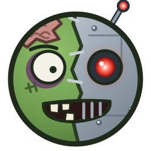
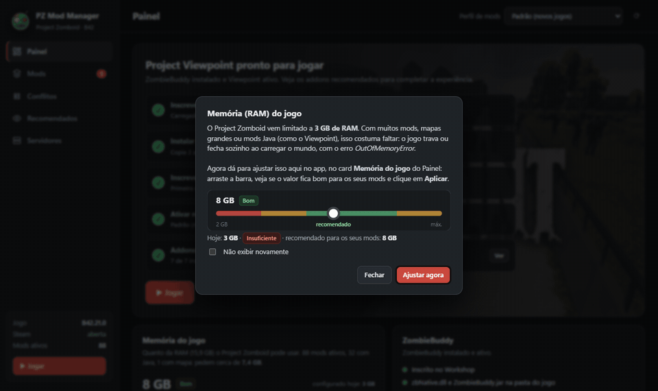
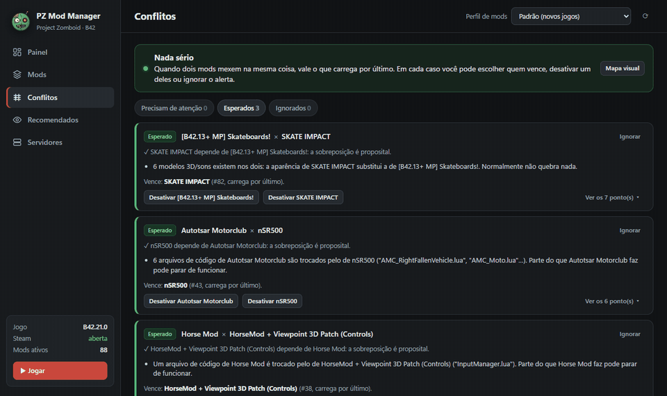

<p align="center">
  
</p>

<h1 align="center">PZ Mod Manager</h1>

<p align="center">
  Gerenciador de mods para <b>Project Zomboid (Build 42)</b> no Windows.<br>
  Ativa mods com as dependências, mostra conflitos e mods obsoletos, configura o <b>Project Viewpoint</b> em um clique e ajusta a memória RAM do jogo.
</p>

<p align="center">
  
</p>

## O que ele faz

### Memória do jogo (RAM)
O Project Zomboid vem limitado a **3 GB de RAM**. Com muitos mods, mapas grandes ou mods Java, o jogo trava ou fecha ao carregar o mundo (`OutOfMemoryError`). O app estima quanto os seus mods ativos precisam e mostra se o valor escolhido é **Insuficiente**, **Apertado**, **Bom** ou se deixa pouca RAM para o Windows. A mudança só é gravada quando você clica em **Aplicar**.

<p align="center"></p>

### Conflitos entre mods
Mostra quando dois mods ativos mexem na mesma coisa e qual deles vence (o que carrega por último). Ele compara arquivos de código, itens, veículos, receitas, modelos 3D e células de mapa. Cada caso vem explicado em português e com botões para **escolher quem vence**, **desativar** um dos mods ou **ignorar** o alerta. Patches e dependências são reconhecidos como **Esperados**, e há um mapa visual dos cruzamentos.

<p align="center"></p>

### Mods, dependências e obsoletos
- Ativa e desativa mods por perfil: **novo jogo**, cada **save** e cada **servidor** que você hospeda (`Mods=`, `WorkshopItems=` e `Map=` atualizados juntos).
- Ativa as dependências junto, avisa o que falta e abre a página do Workshop para você se inscrever.
- Ajusta a **ordem de carregamento** respeitando `require`, `loadModAfter` e `loadModBefore`.
- Marca mods **obsoletos** (só B41, removidos do Workshop, feitos para uma versão anterior do jogo ou marcados pelo autor como descontinuados) e os que **podem ficar obsoletos** em breve.
- Busca, filtros e o botão **Corrigir automaticamente**.

<p align="center"></p>

### Project Viewpoint em um clique
Inscreve no **ZombieBuddy** e no **Project Viewpoint**, instala o ZombieBuddy na pasta do jogo e ativa os dois no perfil escolhido. A aba **Recomendados** lista os addons do Viewpoint mais usados, direto do Workshop.

## Requisitos
- Windows 10 ou 11 (64 bits)
- Project Zomboid **Build 42** pela Steam
- [.NET 10 Desktop Runtime](https://dotnet.microsoft.com/download/dotnet/10.0) e o WebView2 Runtime (já vem com o Windows 11 e com o Edge)

## Como usar
1. Baixe o código e rode o `build.ps1` (precisa do [.NET 10 SDK](https://dotnet.microsoft.com/download/dotnet/10.0)):
   ```powershell
   powershell -ExecutionPolicy Bypass -File build.ps1
   ```
   O `PZModManager.exe` aparece na pasta raiz.
2. Abra o app. Ele encontra sozinho a Steam, o jogo, a pasta do Workshop e a pasta `Zomboid`.
3. Escolha o perfil no topo (novo jogo, um save ou um servidor) e ative os mods na aba **Mods**.

## O que ele altera no seu PC
| Arquivo | Quando |
|---|---|
| `Zomboid\mods\default.txt`, `Saves\...\mods.txt`, `Server\*.ini` | Ao ativar ou desativar mods |
| `ProjectZomboid64.json` / `.bat` (pasta do jogo) | Ao aplicar a memória ou instalar o ZombieBuddy (`-Xmx`, `-agentlib:zbNative`) |
| `zbNative.dll`, `ZombieBuddy.jar` (pasta do jogo) | Ao instalar o ZombieBuddy |

- Antes de alterar qualquer um deles, o app guarda uma cópia em `dados\backups\AAAA-MM-DD\`.
- A gravação é feita primeiro num arquivo temporário, que só depois substitui o original. Assim, uma queda no meio não corrompe o arquivo.
- Com o jogo aberto, o app não mexe nesses arquivos.
- O app não envia nenhum dado seu. Ele só consulta a API pública e as páginas do Steam Workshop, para títulos, imagens e itens obrigatórios.

> **Mods Java** (como o Viewpoint) rodam com acesso total ao PC. O ZombieBuddy pergunta antes de carregar cada um, e o app mantém essa proteção ligada. Use apenas mods em que você confia.

## Segurança
O projeto passou por um pentest com duas rodadas, e todos os achados foram corrigidos e retestados. O relatório está em [`docs/seguranca/pentest-2026-11-07.md`](docs/seguranca/pentest-2026-11-07.md).

## Estrutura
```
src/
  Core/        detecção do jogo, leitura de mods, perfis, conflitos, memória, ZombieBuddy, Steam
  ui/          interface (HTML + JS, roda dentro do WebView2)
  MainForm.cs  janela e ponte entre a interface e o C#
docs/          imagens do README e relatório de segurança
build.ps1      compila e copia o exe para a raiz
```

## Créditos
- **Project Viewpoint**, de ellu e norkus: [Steam Workshop](https://steamcommunity.com/sharedfiles/filedetails/?id=3809306528)
- **ZombieBuddy**, de zed_0xff: [Steam Workshop](https://steamcommunity.com/sharedfiles/filedetails/?id=3619862853)
- **Project Zomboid** é da The Indie Stone.

Este é um projeto independente e não tem relação oficial com a The Indie Stone, com os autores do Project Viewpoint nem com os do ZombieBuddy.
