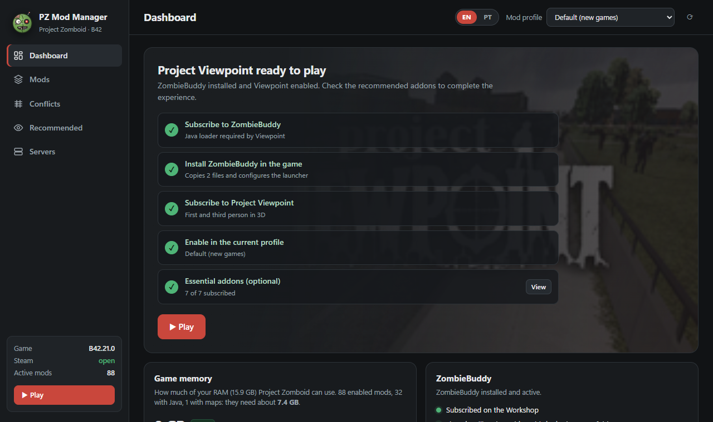
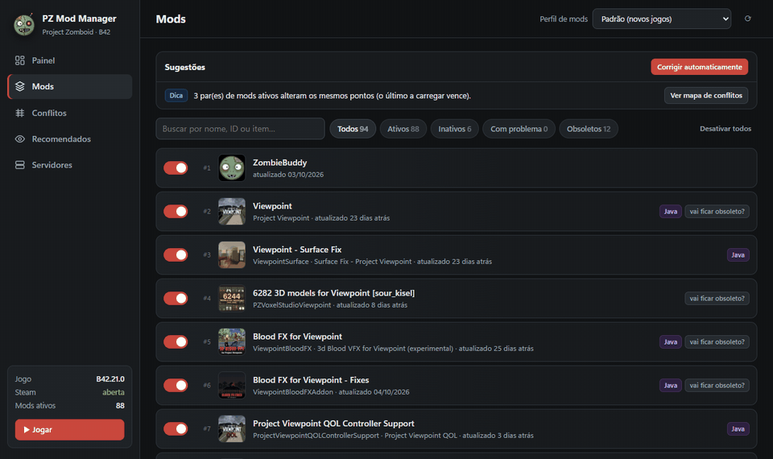

<p align="center"><b>English</b> | <a href="README.pt-BR.md">Português</a></p>

<p align="center">
  
</p>

<h1 align="center">PZ Mod Manager</h1>

<p align="center">
  Mod manager for <b>Project Zomboid (Build 42)</b> on Windows.<br>
  Enables mods together with their dependencies, shows conflicts and outdated mods, sets up <b>Project Viewpoint</b> in one click and adjusts the game's RAM.
</p>

<p align="center">
  
</p>

> The interface is available in **English** (default) and **Brazilian Portuguese**: switch with the **EN | PT** toggle at the top of the window.

## What it does

### Game memory (RAM)
Project Zomboid ships limited to **3 GB of RAM**. With many mods, large maps or Java mods, the game freezes or closes while loading the world (`OutOfMemoryError`). The app estimates how much your active mods need and shows whether the chosen value is **Insufficient**, **Tight**, **Good** or leaves too little RAM for Windows. Nothing is written until you click **Apply**.

<p align="center"></p>

### Mod conflicts
Shows when two active mods change the same thing and which one wins (the one loaded last). It compares code files, items, vehicles, recipes, 3D models and map cells. Each case comes with an explanation and buttons to **choose the winner**, **disable** one of the mods or **ignore** the warning. Patches and dependencies are recognized as **Expected**, and there is a visual map of the overlaps.

<p align="center"></p>

### Mods, dependencies and outdated mods
- Enables and disables mods per profile: **new game**, each **save** and each **server** you host (`Mods=`, `WorkshopItems=` and `Map=` updated together).
- Enables dependencies along with the mod, warns about what is missing and opens the Workshop page so you can subscribe.
- Fixes the **load order** following `require`, `loadModAfter` and `loadModBefore`.
- Flags **outdated** mods (B41 only, removed from the Workshop, made for an earlier game version or marked as discontinued by the author) and the ones that **may become outdated** soon.
- Search, filters and an **Auto-fix** button.

<p align="center"></p>

### Project Viewpoint in one click
Subscribes to **ZombieBuddy** and **Project Viewpoint**, installs ZombieBuddy into the game folder and enables both in the chosen profile. The **Recommended** tab lists the most used Viewpoint addons, straight from the Workshop.

## Download

<p align="center">
  <a href="https://github.com/Luc4sL4mou/PZModManager/releases/latest/download/PZModManager-win-x64.zip"><b>⬇ Download PZ Mod Manager (Windows, .zip)</b></a><br>
  <sub><a href="https://github.com/Luc4sL4mou/PZModManager/releases/latest">all versions and SHA-256</a></sub>
</p>

1. Download the `.zip` above.
2. Extract it to any folder (right-click → **Extract All**).
3. Open **`PZModManager.exe`**. Nothing to install.

It finds Steam, the game, the Workshop folder and the `Zomboid` folder by itself. Then pick the profile at the top (new game, a save or a server) and enable mods in the **Mods** tab.

> **"Windows protected your PC"?** The app is not digitally signed yet, so Windows shows this warning the first time you open it. Click **More info → Run anyway**. The code is open source, every release is built by GitHub Actions from this repository, and the SHA-256 of each version is on the Release page.

**Requirements:** Windows 10 or 11 (64-bit), Project Zomboid **Build 42** on Steam and the WebView2 Runtime, which ships with Windows 11 and Edge. .NET is bundled inside the exe.

The app's settings and backups live in the `dados` folder next to the exe. To "uninstall", just delete the folder.

## What it changes on your PC
| File | When |
|---|---|
| `Zomboid\mods\default.txt`, `Saves\...\mods.txt`, `Server\*.ini` | When you enable or disable mods |
| `ProjectZomboid64.json` / `.bat` (game folder) | When you apply memory or install ZombieBuddy (`-Xmx`, `-agentlib:zbNative`) |
| `zbNative.dll`, `ZombieBuddy.jar` (game folder) | When you install ZombieBuddy |

- Before changing any of them, the app saves a copy to `dados\backups\YYYY-MM-DD\`.
- The **Restaurar originais** (Restore originals) button (Dashboard → Instalação) puts `ProjectZomboid64.json` and `.bat` back to the copy taken before the app's first change. This removes the ZombieBuddy and memory settings.
- Files are written to a temporary file first, which then replaces the original, so a crash halfway does not corrupt it.
- While the game is running, the app does not touch these files.
- The app does not send any of your data. It only queries the public Steam Workshop API and pages, for titles, images and required items.

> **Java mods** (like Viewpoint) run with full access to your PC. ZombieBuddy asks before loading each one, and the app keeps that protection on. Only use mods you trust.

## Security
The project went through a two-round pentest, and all findings were fixed and retested. The report (in Portuguese) is at [`docs/seguranca/pentest-2026-11-07.md`](docs/seguranca/pentest-2026-11-07.md).

## Automated builds
The zip of every Release is built by GitHub Actions from this code ([`.github/workflows/release.yml`](.github/workflows/release.yml)), with a build provenance attestation. To check that a downloaded file came from this repository:
```powershell
gh attestation verify PZModManager-win-x64.zip --repo Luc4sL4mou/PZModManager
```
Publishing steps (VirusTotal, SignPath signing, announcement checklist), in Portuguese: [`docs/PUBLICACAO.md`](docs/PUBLICACAO.md).

## For developers
Requires the [.NET 10 SDK](https://dotnet.microsoft.com/download/dotnet/10.0).
```powershell
powershell -ExecutionPolicy Bypass -File build.ps1    # quick exe in the root folder (uses the installed .NET)
powershell -ExecutionPolicy Bypass -File release.ps1  # Release zip in release\ (exe with .NET inside + SHA-256)
```

## Structure
```
src/
  Core/        game detection, mod scanning, profiles, conflicts, memory, ZombieBuddy, Steam
  ui/          interface (HTML + JS, runs inside WebView2)
  MainForm.cs  window and bridge between the interface and C#
docs/          README images, security report and publishing guide
.github/       automated Release build (GitHub Actions)
build.ps1      builds and copies the exe to the root folder
release.ps1    builds the Release zip (self-contained exe + SHA-256)
```

## Credits
- **Project Viewpoint**, by ellu and norkus: [Steam Workshop](https://steamcommunity.com/sharedfiles/filedetails/?id=3809306528)
- **ZombieBuddy**, by zed_0xff: [Steam Workshop](https://steamcommunity.com/sharedfiles/filedetails/?id=3619862853)
- **Project Zomboid** is made by The Indie Stone.

This is an independent project with no official relation to The Indie Stone, the Project Viewpoint authors or the ZombieBuddy author.

## License
[MIT](LICENSE). The app does not redistribute ZombieBuddy or Viewpoint files: they come from the Workshop items you subscribe to.
